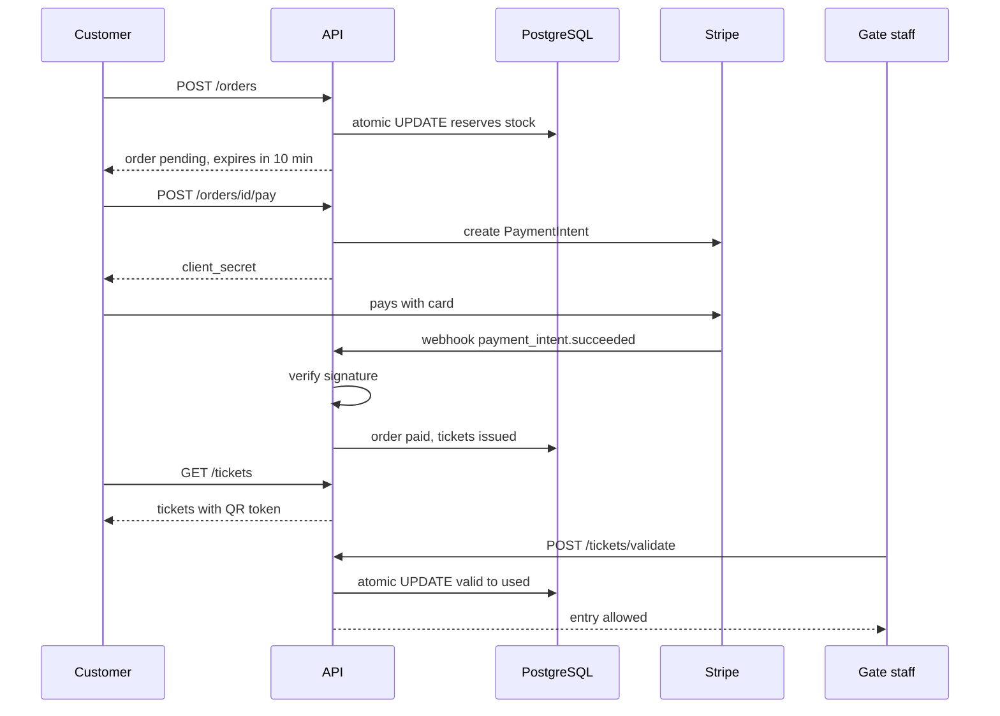

# Pektiket


A backend API for selling event tickets, built with **FastAPI**, **PostgreSQL**, **Redis** and **Stripe**.
It handles accounts, events, stock-safe ticket reservations, card payments, and signed QR tickets with entry validation.

## Features

- **Accounts and roles**: registration, login with JWT, roles `user`, `organizer`, `admin`
- **Events and ticket types**: CRUD for organizers, public paginated listing
- **Reservations**: tickets are held for 10 minutes, expired holds are released automatically
- **Payments**: Stripe PaymentIntents, signed webhooks, tickets issued only after confirmed payment
- **QR tickets**: each ticket has an HMAC-signed QR code, one-time validation at the entrance
- **Consistent errors**: every error has the shape `{"error": {"code": "...", "message": "..."}}`

## Architecture



Code layout:

```
app/
  routers/    HTTP endpoints
  schemas/    request and response validation (Pydantic)
  models/     database tables (SQLAlchemy)
  services/   business logic (reservations, payments, ticket validation)
  core/       shared tools: security, auth dependencies, rate limiting, QR, errors
alembic/      database migrations
tests/        85 automated tests
```

## Design decisions

- **No overselling.** Stock is decreased with one atomic `UPDATE ... WHERE sold + qty <= total`, so concurrent buyers cannot take the same last ticket. A test fires 20 parallel purchases at 5 tickets and asserts exactly 5 succeed. Database `CHECK` constraints are a second line of defence.
- **Webhooks are verified and idempotent.** Signatures are checked before anything is processed. Every Stripe event id is stored, and handling an event is one transaction, so duplicates and retries are safe.
- **Late payments are handled.** If a payment arrives after the hold expired, the API tries to re-claim the tickets, and automatically refunds the customer if they are gone.
- **Amounts are never trusted from the client.** The server computes the price, and the webhook amount is compared with the order total.
- **One-time QR validation.** Tickets are marked used with an atomic conditional update, so two scanners cannot admit the same ticket. Only the event organizer or an admin can scan.
- **Money is stored as integer cents.**

## Security

- Passwords hashed with Argon2; login does not reveal whether an email exists
- JWT access tokens with expiry; role checks on every protected route
- SQL injection prevented by parameterized queries (SQLAlchemy ORM)
- Redis rate limiting on login (per IP and per email), registration, ordering and scanning
- Reservation limits per user to stop bots from hoarding tickets
- Strict input validation, CORS allow-list, security headers, no API docs in production
- Card data never touches the server, Stripe handles it

## Run locally

```bash
cp .env.example .env            # then fill in SECRET_KEY and Stripe test keys
docker compose up -d            # PostgreSQL and Redis
pip install -r requirements.txt
alembic upgrade head
uvicorn app.main:app --reload
```

Open http://localhost:8000/docs for the interactive API docs.

Or run everything in containers:

```bash
docker compose --profile full up --build
```

## Tests

```bash
docker compose exec db psql -U pektiket -d pektiket -c "CREATE DATABASE pektiket_test"
python -m pytest -v
```

Tests run against a separate database. Stripe calls are mocked, while webhook signature verification uses the real code.

## Trying payments locally

Install the [Stripe CLI](https://docs.stripe.com/stripe-cli), then:

```bash
stripe listen --events payment_intent.succeeded,payment_intent.payment_failed --forward-to localhost:8000/webhooks/stripe
stripe payment_intents confirm pi_XXX --payment-method pm_card_visa
```

Put the printed `whsec_...` into `STRIPE_WEBHOOK_SECRET` in `.env`.

## Known limitations

- Free tickets are not supported (Stripe minimum is 0.50 EUR)
- Expired reservations are released lazily on request, not by a background job
- No frontend yet
